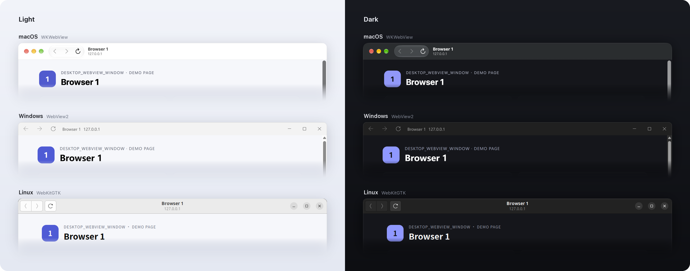

# desktop_webview_window

[](https://pub.dev/packages/desktop_webview_window)

Open web pages in native browser windows from a Flutter desktop application.

| Platform | Support | Engine |
| -------- | ------- | ------ |
| Windows  | ✅ | [WebView2](https://developer.microsoft.com/en-us/microsoft-edge/webview2) (SDK 1.0.4258.31) |
| Linux    | ✅ | [WebKitGTK 4.1](https://webkitgtk.org/reference/webkit2gtk/stable/index.html) or [4.0](https://webkitgtk.org/reference/webkit2gtk/2.5.1/) |
| macOS    | ✅ | WKWebView, macOS 10.15 or later |



The example's built-in demo page with the default native title bar on each platform, in light and dark mode.

## Contents

- [Setup](#setup)
- [Getting started](#getting-started)
- [Talking to the page](#talking-to-the-page)
- [Navigation](#navigation)
- [Controlling the window](#controlling-the-window)
- [Page dialogs, files and downloads](#page-dialogs-files-and-downloads)
- [Custom window layout](#custom-window-layout)
- [Platform support](#platform-support)
- [Migrating to 0.4.0](#migrating-to-040)
- [Development](#development)

## Setup

Requires Flutter 3.44.0 or later. No runner changes or startup hooks are
needed. Each platform has its own runtime requirements.

### Linux

Install WebKitGTK and libsoup development packages.

Ubuntu/Debian:

```shell
sudo apt-get install libwebkit2gtk-4.1-0 libwebkit2gtk-4.1-dev libsoup-3.0-0 libsoup-3.0-dev
```

Fedora:

```shell
sudo dnf install webkit2gtk4.1 webkit2gtk4.1-devel libsoup3 libsoup3-devel
```

### Windows

The **WebView2 Runtime** must be installed. It ships with Windows 11 but may be
missing on Windows 10, so plan how to
[distribute it](https://docs.microsoft.com/en-us/microsoft-edge/webview2/concepts/distribution)
to your users. `WebviewWindow.isWebviewAvailable()` reports whether it is
present.

WebView2 stores its profile in `webview_window_WebView2` next to the
executable by default. If the application is installed in a read-only
directory, browser creation fails with a `PlatformException` whose code is
`create_failed`. Handle creation errors in the application and choose a writable
folder. Add `path_provider` and `path` to your dependencies, then use the
application support directory:

```dart
import 'package:desktop_webview_window/desktop_webview_window.dart';
import 'package:path/path.dart' as p;
import 'package:path_provider/path_provider.dart';

// Call after Flutter's widget binding has been initialized.
final supportDirectory = await getApplicationSupportDirectory();
final webview = await WebviewWindow.create(
  configuration: CreateConfiguration(
    windows: WindowsWebviewOptions(
      userDataFolder: p.join(supportDirectory.path, 'WebView2'),
    ),
  ),
);
```

A relative path is resolved against the executable's directory.

Windows builds download the pinned WebView2 SDK from NuGet and statically link
its loader for x64 or ARM64. No separate `WebView2Loader.dll` is required; the
WebView2 Runtime is still required on the user's machine.

The SDK is downloaded into the application's CMake build directory under
`build/windows/<architecture>/_deps`. Repeated builds reuse it. After
`flutter clean`, the next Windows build downloads it again and needs access
to `api.nuget.org`. No user-wide SDK cache is created.

### macOS

Sandboxed applications need the
`com.apple.security.network.client` entitlement to load pages, and
`com.apple.security.files.user-selected.read-write` for file choosers and
downloads.

## Getting started

```dart
import 'package:desktop_webview_window/desktop_webview_window.dart';

final webview = await WebviewWindow.create();
await webview.launch('https://example.com');
```

The window's native title bar carries back, forward, reload/stop, the page
title and its host, next to the system window buttons:

```
macOS    ● ● ●  ‹ › ⟳  Page title          (NSToolbar, unified)
                       example.com
Windows  ← → ⟳  Page title  example.com      ─ □ ✕   (custom drawn)
Linux    [‹|›] ⟳      Page title       ✕      (GtkHeaderBar)
                      example.com
```

Each item can be hidden:

```dart
CreateConfiguration(
  titleBar: TitleBarOptions(
    showNavigation: true, // back and forward
    showReload: true,     // reload, or stop while loading
    showTitle: true,      // page title, or CreateConfiguration.title
    showHost: false,      // host of the current URL
  ),
)
```

By default, the window title follows the page title, so the Dock, taskbar and
window switchers name the page. On macOS, hiding the page title while showing
the host also uses the host as the window title. For a different layout, see
[Custom window layout](#custom-window-layout).

## Talking to the page

Every top-level page gets the same `window.desktopWebview` object on macOS,
Windows and Linux. Messages carry any JSON-encodable value.

```js
// In the page
window.desktopWebview.postMessage('login', {token: 'abc'});
window.desktopWebview.addEventListener('theme', data => applyTheme(data));
```

```dart
webview.addJavaScriptHandler('login', (data, origin) {
  if (origin != 'https://app.example.com') return;
  print(data); // {token: abc}
});
await webview.postMessage('theme', {'dark': true});
```

The bridge is available to every page the browser navigates to, including
pages a user reaches through links. `origin` identifies the sending document
as `scheme://host[:port]`, `file://` for local files or `null` for opaque
origins; check it before a handler acts on behalf of a trusted page. Messages
from iframes never reach handlers.

`evaluateJavaScript` returns the decoded result (`Map`, `List`, `String`, `num`,
`bool` or `null`). `addScriptToExecuteOnDocumentCreated` runs a script in every
new document before the page's own scripts.

## Navigation

`webview.navigationState` reports `canGoBack`, `canGoForward`, `isLoading`, and
the current page's `url` and `title`. `back`, `forward`, `reload` and `stop`
drive it, so the main application window can draw its own controls.

### Navigation decisions

`setOnUrlRequestCallback` runs before every top-level navigation, including
redirects, while a callback is installed:

```dart
await webview.setOnUrlRequestCallback((url) {
  if (url.startsWith('mailto:')) {
    launchUrl(Uri.parse(url)); // package:url_launcher
    return false;
  }
  return true;
});
```

- The navigation waits for the callback, so it answers synchronously.
- Return false to cancel. A callback that throws allows the navigation.
- Links to schemes the WebView cannot load, such as `mixin:` or `mailto:`,
  reach the callback too. Without a callback they are cancelled.
- `launch(url, triggerOnUrlRequestEvent: false)` skips the decision for that
  navigation.

### Load failures

`onLoadError` reports top-level navigations that could not be loaded:

```dart
webview.onLoadError.listen((error) {
  if (error.kind == WebviewLoadErrorKind.hostLookup) {
    showOfflineBanner(error.url);
  }
});
```

`kind` is one of `hostLookup`, `connection`, `timeout`, `certificate` or
`other`; `description` is the platform's message for logs. Cancelled and
declined navigations, downloads, HTTP error responses, and failures of
subresources or iframes are not reported. On Windows, WebView2 reports some
connection failures, such as a refused connection, without a cause; they are
reported as `connection`.

## Controlling the window

The plugin owns each browser window but does not move, show or focus it after
creation.

Creation-time placement lives in `CreateConfiguration`: `windowWidth`/
`windowHeight`, `openHidden`, `openMaximized`, and `useWindowPositionAndSize`
with `windowPosX`/`windowPosY`. Without a position the window opens centred.

`openHidden: true` is useful on Windows, where `create` resolves only after
WebView2 has started; a window created visible stays blank until then. WebView2
resumes rendering once the window is shown.

### Native window handle

For anything after creation, `webview.nativeWindowHandle` returns the native
window — `HWND` on Windows, `NSWindow*` on macOS and `GtkWindow*` on Linux — for
a window library or your own FFI code:

```dart
import 'dart:ffi';
import 'package:nativeapi/nativeapi.dart';

final window = Window.createWithNativeWindow(
    Pointer.fromAddress(webview.nativeWindowHandle))!;
window.show();
window.focus();
unawaited(webview.onClose.then((_) => window.dispose()));
```

The handle is borrowed. It is valid until `onClose` completes and is 0
afterwards. Do not destroy or close the window through it, replace its
delegate or window procedure, or keep it beyond `onClose`; call
`webview.close()` instead.

Notes on `nativeapi`: wrapping a window does not destroy it on any desktop
platform (checked against `nativeapi-core` commit `ead6a88`; upstream does not
document this, so recheck when upgrading). On macOS, `setNonActivating(true)`
changes the window class and disables keyboard input in borderless browser
windows.

### Appearance

On macOS and Windows, `CreateConfiguration(brightness: Brightness.dark)` sets
the appearance before the window is shown, including its startup background.
The default, null, follows the system. `setBrightness` changes it later. Pages
see the preference through `prefers-color-scheme`. Linux follows the
application's GTK theme.

### Windows options

`WindowsWebviewOptions` holds options only WebView2 honours:

- `userDataFolder`: the WebView2 profile folder; see [Setup](#windows).
- `denyCameraAndMicrophone: true` denies the page's camera and microphone
  requests without saving the denial in the shared profile. It requires
  WebView2 Runtime 111.0.1661.34 or later; window creation fails on older
  runtimes when it is enabled.

## Page dialogs, files and downloads

The browser handles what pages expect from a browser, the same way on every
platform:

- `alert` and `confirm` open native dialogs on the browser window. `prompt`
  goes to `setPromptHandler` on macOS.
- `<input type="file">` opens the system file chooser.
- Files the page cannot show, or that the server sends as an attachment, ask
  where to save them before downloading. On macOS this needs macOS 11.3.
- Links that open a new window, such as `target="_blank"` and `window.open`,
  load in the same window and reach the [navigation decision](#navigation-decisions).
- Right-clicking shows the WebView's default context menu. On Windows and Linux,
  its Inspect item appears after `openDevToolsWindow()`. On macOS 13.3 or later,
  debug builds enable inspection through Safari's Develop menu;
  `openDevToolsWindow()` is unsupported on macOS.

To disable the context menu, add a script:

```dart
await webview.addScriptToExecuteOnDocumentCreated(
    "document.addEventListener('contextmenu', e => e.preventDefault());");
```

Sandboxed macOS applications need the entitlements listed in [Setup](#macos).

## Custom window layout

A *composer* decides what a browser window contains besides the WebView and
where the WebView sits. The default composer produces the title bar shown in
[Getting started](#getting-started).

For another layout — a sidebar, an overlay, your own toolbar, no title bar at
all — install a native composer from the runner before the first browser is
created. It receives the window and a view containing the WebView, and may
arrange them however it likes. A Linux example:

```c
#include <desktop_webview_window/webview_window_composer.h>

static DWWComposeResult compose(void* user, const DWWComposeRequest* request) {
  if (request->arguments == NULL) return DWW_COMPOSE_DEFAULT;  // Default title bar.
  GtkWidget* row = gtk_box_new(GTK_ORIENTATION_HORIZONTAL, 0);
  gtk_box_pack_start(GTK_BOX(row), my_sidebar(request->browser), FALSE, FALSE, 0);
  gtk_box_pack_start(GTK_BOX(row), GTK_WIDGET(request->webview_view), TRUE, TRUE, 0);
  gtk_container_add(GTK_CONTAINER(request->window), row);
  gtk_widget_show_all(row);
  return DWW_COMPOSE_HANDLED;
}

static const DWWComposer composer = {NULL, compose, navigation_changed, NULL, closing};
dww_set_composer(&composer);  // In the runner, before the first create.
```

- Controls call `dww_browser_go_back`, `dww_browser_reload`,
  `dww_browser_close` and friends with the browser ID. `navigation_changed`
  delivers the navigation state.
- `CreateConfiguration(composerArguments: ...)` reaches `compose` unchanged, so
  one composer can lay out different windows differently.
- Returning `DWW_COMPOSE_DEFAULT` hands that window to the default composer for
  its whole lifetime.
- `request->title_bar` carries the `TitleBarOptions` flags (`DWW_TITLE_BAR_*`)
  for composers that want to honour them.
- A composer may restyle the window, for example to remove its title bar. On
  Windows it handles window messages by subclassing the window with
  `SetWindowSubclass`.

The header documents the window and view types per platform and the rules for
borrowed pointers, closing from inside callbacks, and Windows resizing. The
example runner's `linux/test_composer.cc` is a complete composer, and
[the design](doc/native_window_composer.md) describes the full contract.

The composer is native code, so a Flutter UI inside a browser window means
creating your own Flutter view there. On Linux X11 that is subject to
[Flutter #186577](https://github.com/flutter/flutter/issues/186577), which is
why the plugin itself no longer renders Flutter toolbars.

## Platform support

| Feature | macOS | Windows | Linux |
| --- | --- | --- | --- |
| Page messaging, navigation decisions, script results | ✅ | ✅ | ✅ |
| `nativeWindowHandle`, `openHidden`, `openMaximized`, position | ✅ | ✅ | ✅ |
| `openDevToolsWindow` | ❌ Safari Web Inspector (debug builds) | ✅ | ✅ |
| `setBrightness` | ✅ | ✅ | ❌ |
| `setPromptHandler` | ✅ | ❌ | ❌ |
| `WindowsWebviewOptions` | — | ✅ | — |

Calling an unsupported operation throws `UnsupportedError`. Operations return
futures that complete once native code has applied them and fail with a
`PlatformException` when it reports an error.

## Migrating to 0.4.0

0.4.0 is a breaking release. The APIs below were removed rather than
deprecated.

### Browser API

| Removed API | Replacement |
| --- | --- |
| `registerJavaScriptMessageHandler(name, (name, body) {...})` | `addJavaScriptHandler(name, (data, origin) {...})`; the page calls `window.desktopWebview.postMessage(name, data)` |
| `unregisterJavaScriptMessageHandler` | `removeJavaScriptHandler` |
| `postWebMessageAsString` / `postWebMessageAsJson` | `postMessage(name, data)`; the page listens with `window.desktopWebview.addEventListener(name, ...)` |
| `addOnWebMessageReceivedCallback` and related | `addJavaScriptHandler` |
| `isNavigating` | `navigationState.value.isLoading` |
| `setOnHistoryChangedCallback` | Listen to `navigationState` |
| `moveWebviewWindow`, `setWebviewWindowVisibility`, `bringToForeground`, `getPositionalParameters` | `nativeWindowHandle` with a window library; see [Native window handle](#native-window-handle) |
| `CreateConfiguration(userDataFolderWindows:, denyCameraAndMicrophone:)` | `CreateConfiguration(windows: WindowsWebviewOptions(userDataFolder:, denyCameraAndMicrophone:))` |
| `clearAll(userDataFolderWindows:)` | `clearAll(windows: WindowsWebviewOptions(...))` |

### Title bars

Browser windows no longer run Flutter. Remove the
`runWebViewTitleBarWidget(args)` startup hook and its early return, and delete
the title bar widget:

| Removed API | Replacement |
| --- | --- |
| `runWebViewTitleBarWidget(args, builder: ...)` | The default native title bar, or a [native composer](#custom-window-layout) |
| `TitleBarWebViewController.of(context)` | `dww_browser_*` in a composer, or the `Webview` in Dart |
| `TitleBarWebViewState.of(context)` | `navigation_changed` in a composer, or `webview.navigationState` in Dart |
| `CreateConfiguration(titleBarHeight: 0)` | `CreateConfiguration(titleBar: TitleBarOptions(showNavigation: false, showReload: false))` |
| `CreateConfiguration(titleBarTopPadding: ...)` | Composer layout |

Navigation controls drawn by the main application window can keep using
`webview.back()`, `forward()`, `reload()`, `stop()`, `close()` and
`webview.navigationState`.

### Behavior changes

- `launch`, `close`, `setBrightness`, `setOnUrlRequestCallback`,
  `addScriptToExecuteOnDocumentCreated` and `openDevToolsWindow` return futures
  and report native errors.
- `evaluateJavaScript` returns `Future<Object?>` with the decoded value instead
  of a JSON string.
- `setOnUrlRequestCallback` can cancel navigations on every platform.
- Pages from the old bridges must switch to `window.desktopWebview`;
  `window.webkit.messageHandlers.<name>` and `chrome.webview` messages are no
  longer forwarded.
- On Linux, browser windows are independent top-level windows, as on macOS and
  Windows, instead of transient children of the application window: they no
  longer stay above it, and open centred on the screen.
- macOS cookies now report `expires`, `secure`, `httpOnly` and `sessionOnly`.
- Browser IDs (`Webview.id`) are unique per process.

## Development

See the [example README](example/README.md) for running the demo, unit and
integration tests, platform coverage, and macOS sandbox requirements.

## License

See [LICENSE](./LICENSE).
